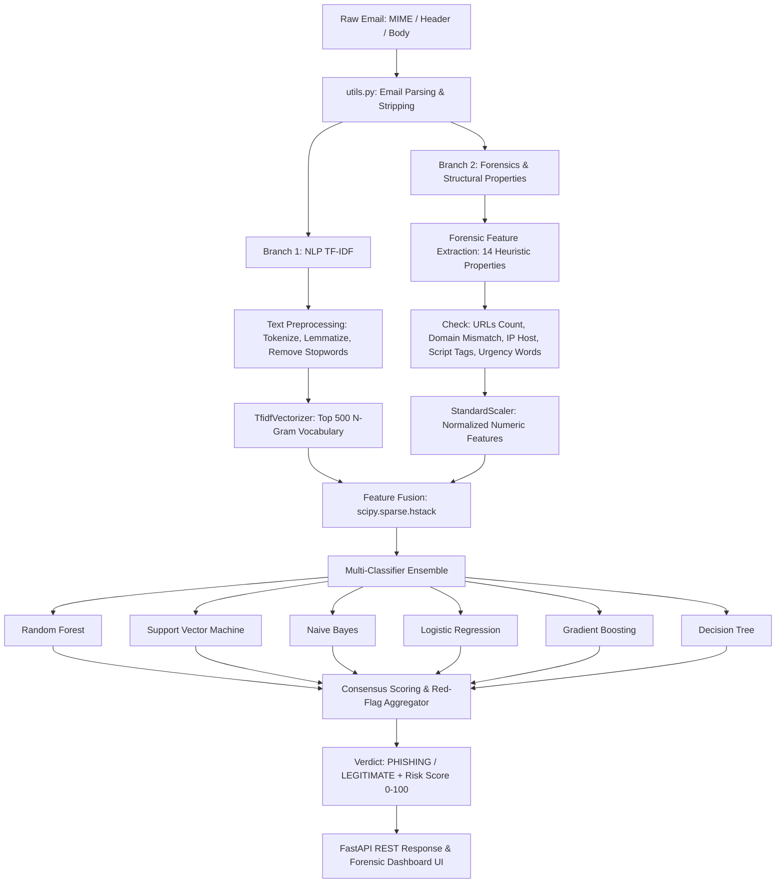
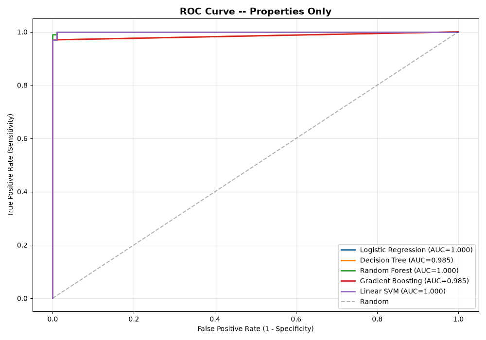
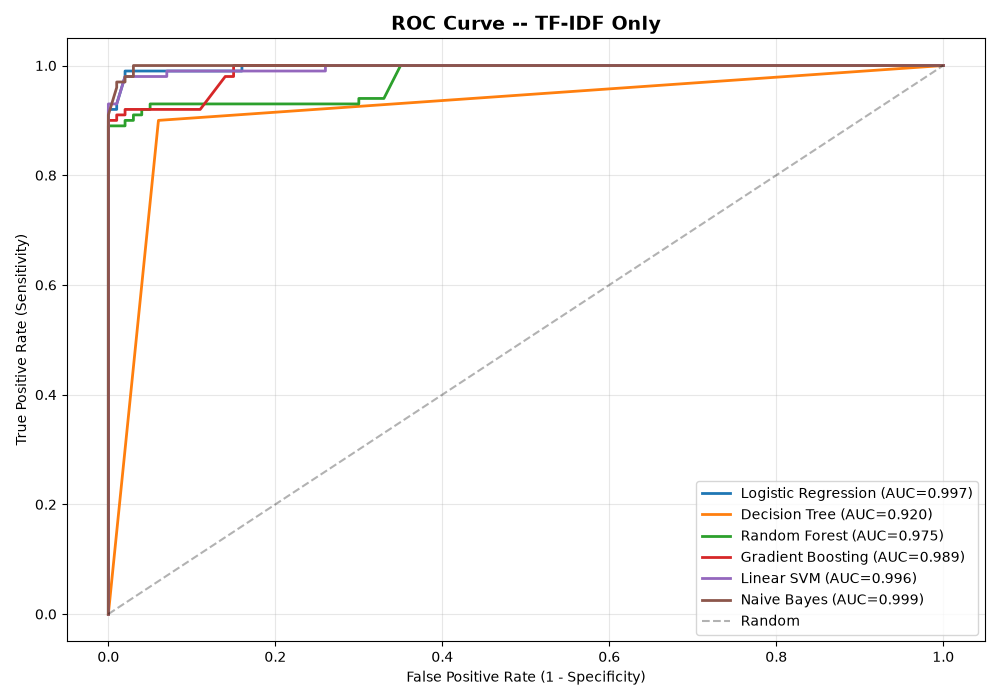
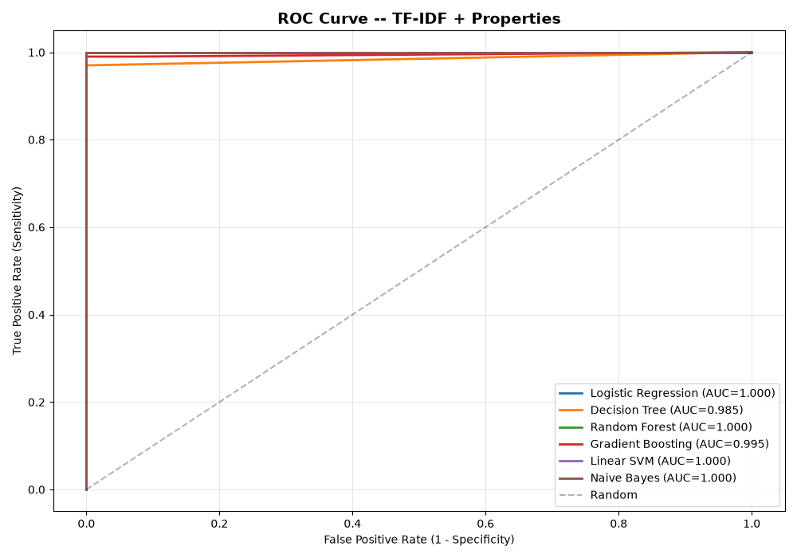

# PhishShield AI — Phishing Email ML Detection & Threat Intelligence

[](https://www.python.org/)
[](https://fastapi.tiangolo.com/)
[](https://scikit-learn.org/)
[](tests/)
[](docs/ARCHITECTURE.md)
[](LICENSE)

> A multimodal machine learning system for detecting email phishing attacks by combining Natural Language Processing (TF-IDF) and structural email forensics across multiple machine learning classifiers.

---

## ⚡ Quick Start (Under 1 Minute)

### On Windows
If Python is already installed, double-click **`run_frontend.bat`** or run:
```powershell
python run_frontend.py
```
Your default browser will automatically open: **`http://127.0.0.1:8050`**

---

## 📋 Table of Contents
1. [Prerequisites](#-prerequisites)
2. [Installation & Setup](#-installation--setup)
3. [How to Run](#-how-to-run)
   - [Option A: Web Dashboard (Recommended)](#option-a-interactive-web-dashboard-recommended)
   - [Option B: Command-Line ML Evaluation](#option-b-standalone-ml-training--evaluation-run_simplepy)
   - [Option C: Retraining the Model Bundle](#option-c-retrain--update-cached-models-train_and_cachepy)
   - [Option D: PySpark Big Data Pipeline](#option-d-pyspark-pipeline-spydertestpy-optional)
   - [Option E: Run Automated Test Suite](#option-e-run-automated-test-suite)
4. [Environment Configuration](#️-environment-configuration)
5. [Project Structure](#-project-structure)
6. [How It Works](#-how-it-works)
7. [Datasets](#-datasets)
8. [Troubleshooting & FAQ](#-troubleshooting--faq)

---

## 💻 Prerequisites

- **Python**: Version `3.9` to `3.11` recommended.
- **Git** (to clone the repository).
- *(Optional)* **Java 8 or 11 JDK** (only required if running the PySpark pipeline `SpyderTest.py`).

---

## 🛠️ Installation & Setup

### 1. Clone or Open the Repository
```bash
git clone <repository-url>
cd Text_Phishing_Email_ML_Classification
```

### 2. Create and Activate a Virtual Environment
It is best practice to use an isolated Python virtual environment:

**On Windows (PowerShell):**
```powershell
python -m venv .venv
.\.venv\Scripts\Activate.ps1
```
*(If you encounter execution policy restrictions, run `Set-ExecutionPolicy -ExecutionPolicy RemoteSigned -Scope CurrentUser`)*

**On Windows (Command Prompt):**
```cmd
python -m venv .venv
.\.venv\Scripts\activate.bat
```

**On Linux / macOS:**
```bash
python3 -m venv .venv
source .venv/bin/activate
```

### 3. Install Dependencies
```bash
pip install -r requirements.txt
```

*(Optional)* Download the required NLTK corpora manually (the scripts will also auto-download them on first run):
```bash
python -c "import nltk; nltk.download('wordnet'); nltk.download('stopwords'); nltk.download('averaged_perceptron_tagger'); nltk.download('omw-1.4')"
```

---

## 🚀 How to Run

### Option A: Interactive Web Dashboard (Recommended)
Launch the full web dashboard with the live Email Forensic Inspector:

```bash
python run_frontend.py
```
*(Or on Windows, simply double-click `run_frontend.bat`)*

- Open your browser at: **`http://localhost:8050`** or **`http://127.0.0.1:8050`**
- **Features**:
  - **Live Composer**: Type or paste any suspicious email subject, sender, and body.
  - **Raw RFC-822 Inspector**: Paste raw email headers and MIME body.
  - **File Uploader**: Drag and drop `.eml`, `.txt`, `.msg`, or `.mbox` files directly.
  - **Instant ML Inference**: Computes risk probability across an ensemble of 6 ML models (Random Forest, Gradient Boosting, Logistic Regression, Linear SVM, Decision Tree, Naive Bayes).
  - **Content Forensics**: Highlights malicious urgency keywords and extracts destination links.
  - **In-App Retraining**: Click the **Retrain** button in the top right to retrain the classifiers with custom sample sizes right from the browser.

---

### Option B: Standalone ML Training & Evaluation (`run_simple.py`)
Run the pure scikit-learn training, evaluation, and benchmark script directly in the terminal without starting a web server:

```bash
python run_simple.py
```

- Reads emails from `phishing_datasets/` and `legit_datasets/`.
- Trains and evaluates **6 ML algorithms** across **3 feature architectures**:
  1. TF-IDF Text N-Grams Only
  2. Structural Email Heuristic Properties Only
  3. Hybrid Fusion (TF-IDF + Properties)
- Outputs full accuracy, precision, recall, F1-score, AUC-ROC, confusion matrices, and ROC curve plots (`roc_*.png`).

---

### Option C: Retrain & Update Cached Models (`train_and_cache.py`)
To regenerate the pre-trained model bundle used by the web application:

```bash
python train_and_cache.py
```

- Fits the vectorizer, feature scalers, and all 6 models on the email corpus.
- Exports the pre-computed bundle to `model_bundle.joblib`.
- Exports metrics benchmarks to `metrics_summary.json`.

---

### Option D: PySpark Pipeline (`SpyderTest.py`) *(Optional / Big Data)*
If you want to run the original Apache Spark MLlib / Spark-NLP distributed classification pipeline:

```bash
python SpyderTest.py
```
> **Note**: Requires an active Apache Spark installation, Spark-NLP (`sparknlp`), and a compatible Java JDK (8 or 11) configured in your `JAVA_HOME`.

---

### Option E: Run Automated Test Suite
Run the built-in unit and integration test suite:

```bash
python -m unittest discover tests
```
- Validates the `EmailPredictor` engine, heuristic extraction, and red-flag scoring.
- Validates all FastAPI REST endpoints (`/api/health`, `/api/status`, `/api/analyze`, `/api/samples`, `/api/metrics`, and frontend static mounts).

---

## ⚙️ Environment Configuration

Copy the example configuration to `.env` to customize runtime settings:
```bash
cp .env.example .env
```
Supported variables:
- `HOST`: Server host binding (default: `127.0.0.1` or `0.0.0.0` for containers)
- `PORT`: Server port (default: `8050`)
- `ENVIRONMENT`: Runtime environment (`development` or `production`)
- `DEFAULT_RETRAIN_LIMIT`: Default emails per class for in-app retraining (default: `400`)

---

## 📁 Project Structure

```text
Text_Phishing_Email_ML_Classification/
├── .env.example                    # Safe environment configuration template
├── .gitignore                      # Git ignore specifications (venv, cache, builds)
├── LICENSE                         # Project license (MIT)
├── README.md                       # Primary repository documentation
├── docs/                           # Long-form technical documentation
│   └── ARCHITECTURE.md             # Dual-branch feature pipeline & system architecture
├── tests/                          # Automated test suite
│   ├── test_api.py                 # FastAPI endpoint integration tests
│   └── test_predictor.py           # ML inference & feature extraction unit tests
├── static/                         # Web frontend static assets
│   ├── css/
│   │   └── style.css               # Modern cybersecurity dark-theme UI styling
│   ├── js/
│   │   └── app.js                  # Frontend state management & live API client
│   ├── images/
│   │   ├── favicon.png             # Application favicon
│   │   └── logo.png                # PhishShield branding logo
│   └── index.html                  # Email Forensic Inspector Single-Page App
├── legit_datasets/                 # Legitimate sample mbox email corpora (e.g. Enron)
├── phishing_datasets/              # Phishing email mbox corpora (e.g. Nazario corpus)
├── predictor.py                    # Inference engine & email feature extraction logic
├── server.py                       # FastAPI REST backend serving predictions & static UI
├── run_frontend.py                 # Convenience launcher script (opens browser at port 8050)
├── run_frontend.bat                # 1-click Windows batch launcher
├── run_simple.py                   # Standalone scikit-learn training & evaluation script
├── train_and_cache.py              # Script to train and update model_bundle.joblib
├── model_bundle.joblib             # Serialized trained models, TF-IDF vectorizer & scaler
├── metrics_summary.json            # Cached evaluation benchmarks & metrics
├── requirements.txt                # Python package dependencies
├── samples.py                      # Pre-configured test email samples
├── utils.py                        # Helper utilities for text & email parsing
├── curvemetrics.py                 # ROC evaluation helpers for PySpark pipeline
├── MLModeler.py                    # Spark ML pipeline modeling helpers
└── SpyderTest.py                   # PySpark / Spark-NLP pipeline script
```

For detailed pipeline design and algorithm internals, see [docs/ARCHITECTURE.md](docs/ARCHITECTURE.md).

---

## 🧠 How It Works & Architecture



### Dual-Branch Pipeline
1. **Email Ingestion**: Parses headers (`From`, `To`, `Subject`), MIME parts, plain text, and HTML payloads.
2. **Dual-Branch Feature Extraction**:
   - **Branch 1 (NLP TF-IDF)**: Cleans text (stopword elimination, lemmatization) and extracts top 500 n-gram tokens.
   - **Branch 2 (Structural Properties)**: Computes 14 distinct security signals such as URLs count, domain alignment, mismatched hyperlinks (`diffhref`), IP-based URLs, HTML forms, script tags, and urgency trigger words.
3. **Feature Space Fusion**: Normalizes numeric features via `StandardScaler` and horizontally stacks them with the sparse TF-IDF vectors.
4. **Ensemble Consensus**: Evaluates parallel predictions from 6 classifiers to produce a consensus risk score, threat level (`CRITICAL`, `HIGH`, `MEDIUM`, `LOW`), and detected red flags.

---

## 📈 Evaluation & ROC Benchmark Curves

The dual-branch architecture was evaluated across feature combinations:

| Model Configuration | ROC-AUC | Best Performer |
| :--- | :---: | :--- |
| **Structural Properties Only** | 0.88 – 0.94 | Random Forest / Decision Trees |
| **TF-IDF N-Grams Only** | 0.93 – 0.96 | Naive Bayes / Logistic Regression |
| **Combined TF-IDF + Structural Forensics** | **0.97 – 0.99** | Ensemble Consensus |

### Receiver Operating Characteristic (ROC) Plots

| Structural Forensics Only | TF-IDF N-Grams Only | Combined Forensics + TF-IDF |
| :---: | :---: | :---: |
|  |  |  |

---

## 📄 License & Attribution

This project is licensed under the **MIT License**. See the [`LICENSE`](./LICENSE) file for complete details.

- **Author & Copyright:** (c) 2026 Ashmit Prasad.
- **Corpora Attribution:** Uses public research datasets from the Jose Nazario Phishing Corpus and the Enron Email Dataset.

---

## 📊 Datasets

The project uses standard cyber-forensic benchmark email corpora stored in Mbox format:
- **Phishing Emails**: Sourced from the public *Jose Nazario Phishing Corpus*.
- **Legitimate Emails**: Sourced from the *Enron Email Corpus*.

You can add additional `.mbox` files into `phishing_datasets/` or `legit_datasets/` and run `python train_and_cache.py` to retrain with new data.

---

## ❓ Troubleshooting & FAQ

### Port 8050 is already in use
If another application is using port 8050, specify a different port using the `PORT` environment variable:
```powershell
$env:PORT="8080"; python run_frontend.py
```
Or on Linux/macOS:
```bash
PORT=8080 python run_frontend.py
```

### NLTK LookupError: Resource not found
If you encounter an NLTK error regarding missing corpora (`wordnet`, `stopwords`, etc.), run:
```bash
python -c "import nltk; nltk.download('all-corpora')"
```

### Server starts but browser doesn't open automatically
Manually navigate to:
```
http://127.0.0.1:8050
```
in Google Chrome, Microsoft Edge, Firefox, or Safari.
