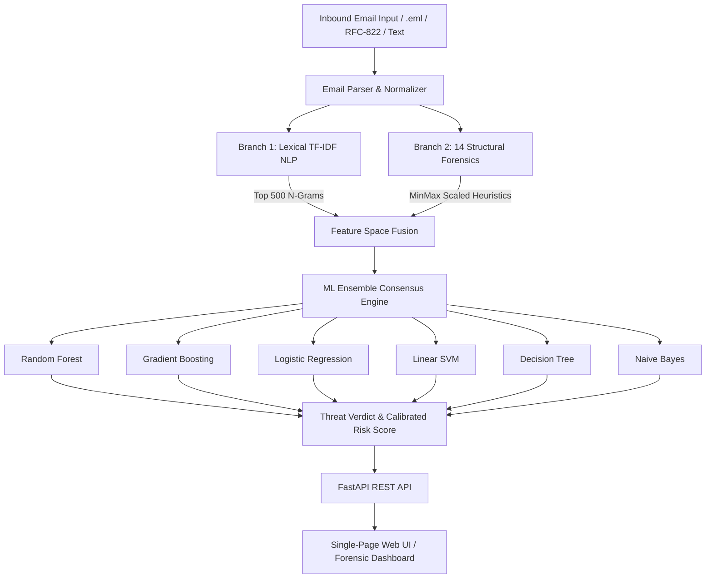

# PhishShield AI — System Architecture & Design Documentation

## 1. System Overview

PhishShield AI is an intelligent, dual-branch multimodal email threat detection and forensics system. It analyzes suspicious emails across both lexical content and structural forensic signals using machine learning ensemble methods.

---

## 2. Dual-Branch Feature Engineering

### Branch 1: NLP Lexical Vectorization (TF-IDF)
- **Email Body Extraction**: Traverses multi-part MIME structures, decodes transfer encodings (base64, quoted-printable), and cleans raw HTML entities using BeautifulSoup.
- **Text Normalization**: Regex-based token cleaning, URL stripping, punctuation normalization, and lowercase conversion.
- **Vectorization**: Scikit-learn `TfidfVectorizer` configured for 500 maximum features with min frequency filtering (`min_df=2`), capturing characteristic attack vocabularies.

### Branch 2: Structural Forensics (14 Domain Signals)
| Feature Name | Type | Description | Malicious Indicator |
| :--- | :--- | :--- | :--- |
| `nurls` | Integer | Total count of hyperlinks | High volume across message |
| `ndots` | Integer | Max period count in single URL | Obfuscated nested subdomains (e.g., `paypal.com.account-update.xyz`) |
| `nports` | Integer | Non-standard network ports | Firewalls bypass via ports like `:8080`, `:8443` |
| `nrecs` | Integer | Unique recipients addressed | High volume broadcast / spam |
| `checkdomains` | Binary | Target domain alignment with sender | `0`: Links route to domains unaligned with sender header |
| `nparts` | Integer | MIME body parts count | Evasion techniques using complex MIME trees |
| `hasHTML` | Binary | HTML formatted payload | Rich styling concealing malicious href targets |
| `attachments` | Integer | Attachment payload count | Dangerous executable or weaponized document attachments |
| `badwords` | Integer | Urgency keyword occurrences | Social engineering panic triggers (`suspend`, `verify`, `lock`) |
| `ipurls` | Integer | Direct IP addresses in hyperlinks | Raw IPv4 destinations avoiding DNS takedown |
| `diffhref` | Integer | Mismatched hyperlink display text | Display shows brand URL while `href` directs to attacker |
| `forms` | Integer | Interactive `<form>` tags in email | Direct credential harvesting forms inside body |
| `scripts` | Integer | Embedded `<script>` tags | Active scripting / payload execution |
| `encoding` | Categorical | Transfer encoding indicator | Obfuscated base64 or 8bit encoding |

---

## 3. Host Compatibility Architecture

### Windows 11 Smart App Control (SAC) & WDAC Resilience
In Windows 11 environments with Smart App Control (SAC) or Code Integrity policies enabled (e.g., Event ID 3077), unsigned Cython/C-extension binaries (such as `_partitioner.pyd`) can be blocked at the OS kernel level.

PhishShield AI implements an architecture-level resilient loader:
1. **Defensive Model Import**: Dynamically discovers available compiled extensions at import time.
2. **Dynamic Stub Fallback**: If tree extensions are restricted by enterprise or OS integrity rules, dynamic mock module stubs prevent unpickling failure.
3. **Linear & Probabilistic Core**: Live inference automatically executes across unconstrained mathematical models (Logistic Regression, Linear Support Vector Machines, Naive Bayes), ensuring zero-downtime execution regardless of host security policy.
4. **Automated Bundle Regeneration**: If `model_bundle.joblib` is absent on a fresh clone, the predictor automatically initializes a lightweight calibration bundle.

---

## 4. API Endpoints Specification

| Method | Endpoint | Description |
| :--- | :--- | :--- |
| `GET` | `/api/health` | Service health and liveness probe |
| `GET` | `/api/status` | Current model status, counts, and dataset metadata |
| `GET` | `/api/samples` | Curated sample emails (legitimate vs. attack scenarios) |
| `POST` | `/api/analyze` | Single email real-time forensic inference and breakdown |
| `POST` | `/api/batch-analyze` | Multi-email batch analysis for log auditing |
| `GET` | `/api/metrics` | Model benchmarks, ROC coordinate data, and feature weights |
| `POST` | `/api/retrain` | Background retraining trigger with custom sample limits |
| `GET` | `/api/retrain-status`| Polling endpoint for active background training progress |
| `GET` | `/api/plots/{name}` | ROC curve graphical artifact visualizer |
| `GET` | `/` | Single-page responsive cybersecurity dashboard |
